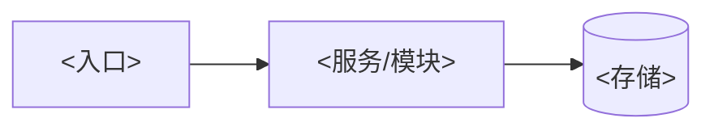

# 决策简报骨架

整份复制，按占位符替换。删掉所有 `<...>` 与提示行再交。全文 ≤600 字。

---

# <主题> 决策简报

## 结论

选：<方案，一句话。>
不选：<被排除的选项 / 维持现状，一句话。>
不做的后果：<一句话。>

## 关键取舍

| 选项 | 选择 | 代价 |
|---|---|---|
| <A / B / 维持现状> | <选了哪个> | <复杂度、工期、风险各一句> |

## 一张图

## 需要拍板

- <问题>：默认 <选项>；不拍板 <后果>；由 <角色> 定。
- 无则写：无需拍板，按默认执行。

## 最大风险与反转信号

- 最可能错在：<一句>。
- 看到 <指标 / 事件 / 报错> 就 <回退到 X / 改方案>。
- 回退：<命令或操作，一句话>。

## 详情

- 方案：<路径或链接>@<版本>
- 代码基线：<repo@commit>
- ADR：<编号，无则写「无」>
